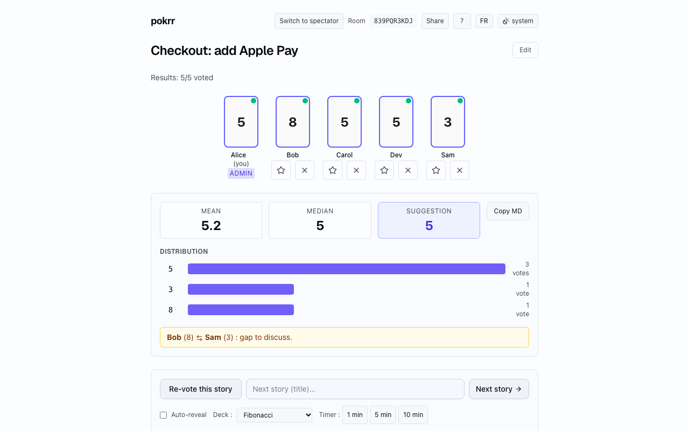

# pokrr

**Free real-time planning poker for agile teams. No sign-up, no install, no ads.**

[pokrr.app](https://pokrr.app/en) · [Français](https://pokrr.app/fr) · [Planning poker guide](https://pokrr.app/en/blog/complete-guide-planning-poker)



Create a room in one click, share the link or QR code, and estimate user stories together. Participants join with a nickname only: no account, no email. Votes stay hidden until the reveal, so nobody anchors on someone else's estimate.

- Six card decks: Fibonacci, Fibonacci + ½, modified Fibonacci, T-shirt sizing, powers of 2, hours
- Manual or automatic reveal, then mean, median, suggested value, distribution and a flag on the largest gap between voters
- Story timer, several admins per room, admin transfer, spectator mode
- Share by link or QR code, copy results as Markdown
- Keyboard shortcuts, light and dark themes, English and French
- No personal data stored server-side: rooms live in memory only

---

## Documentation technique (FR)

Planning poker minimaliste : gratuit, sans pub, sans inscription. Stack Next.js 16 + PartyServer (Cloudflare Workers + Durable Objects). Coût d'hébergement cible 0 €/mois en restant dans les free tiers Cloudflare et Vercel.

## Stack

- **Front** : Next.js 16 App Router, Tailwind v4, React 19. Déployé sur Vercel Hobby.
- **Backend temps réel** : PartyServer (= Cloudflare Workers + Durable Objects, un DO par roomId), déployé avec `wrangler` sur ton compte Cloudflare. La plateforme PartyKit hébergée a fermé le 23/10/2026.
- **State** : in-memory dans le DO PartyServer (pas de DB, pas de `room.storage`). Une room vit tant qu'une connexion WebSocket est ouverte, puis Cloudflare évince le DO 1 à 3 min après la dernière déconnexion et l'état est perdu → coût ressources ≈ 0. Un `npm run party:deploy` redémarre les DO et vide toutes les rooms en cours : éviter de déployer pendant une session.

## Lancer en local

```bash
npm install
npm run dev
```

- Front : http://localhost:3000
- Serveur de salles (`wrangler dev`) : ws://localhost:1999
- Page status : http://localhost:3000/status

Les deux serveurs tournent en parallèle via `concurrently`.

### Tests

Prérequis : `npm run dev` doit tourner dans un autre terminal (port 3000 + 1999).

```bash
npm run smoke           # 23 assertions backend (happy path)
npm run smoke:election  # 7 assertions élection admin auto (POKRR_ADMIN_GRACE_MS=2000)
npm run smoke:security  # 20 assertions sécurité (CSWSH, XSS, admin usurp, voterId, JSON, HTTP sur /parties/)
npm run test:e2e        # 1 test Playwright (3 voters, happy path complet)
```

Tests unitaires (vitest, sans serveur) : `npm test` (`tests/unit/` : logique de jeu `GameRoom`, stats, sanitisation).

Total : **50 assertions backend + tests unitaires + 1 E2E**. CI GitHub Actions (`.github/workflows/ci.yml`) sur chaque push vers `main` et sur chaque pull request : lint, typecheck (front et Worker), build, audit, tests unitaires, knip, puis les 3 smokes contre `wrangler dev`.

## Déploiement

### 1. PartyServer → ton compte Cloudflare

```bash
npx wrangler login         # OAuth Cloudflare via navigateur
npm run party:deploy       # wrangler deploy, publie sur pokrr.<sous-domaine>.workers.dev
```

Note l'URL renvoyée, c'est ton `NEXT_PUBLIC_PARTYKIT_HOST` pour Vercel.

### 2. Front → Vercel

```bash
npx vercel login           # OAuth Vercel
npx vercel                 # premier deploy, prompts → accepter les défauts
# Ajouter la variable d'env côté Vercel (Settings → Environment Variables) :
#   NEXT_PUBLIC_PARTYKIT_HOST = pokrr.<sous-domaine>.workers.dev
#   (optionnel) NEXT_PUBLIC_SITE_URL = https://<ton-domaine>
npx vercel --prod          # production deploy
```

### 3. Custom domain (optionnel)

- **Vercel** : Project → Settings → Domains → ajouter `pokrr.app` (ou autre).
- **Worker** : Workers Custom Domains ou Routes → mapper un sous-domaine type `ws.pokrr.app` vers le Worker (sinon garder l'URL `*.workers.dev`).

### 4. Smoke test prod

```bash
# Sanité de base
curl -sS https://<ton-domaine>/api/health | jq

# Page de statut visuelle
open https://<ton-domaine>/status
```

Ouvre la home, crée une salle, ouvre le lien dans un 2e navigateur, vote, vérifie auto-reveal.

## Variables d'environnement

Voir `.env.example`. Récap :

| Variable | Côté | Rôle |
|---|---|---|
| `NEXT_PUBLIC_PARTYKIT_HOST` | Next | Hostname du Worker (sans protocole) |
| `NEXT_PUBLIC_SITE_URL` | Next | URL canonique pour `metadataBase` OG/Twitter (optionnel) |
| `POKRR_ADMIN_GRACE_MS` | Worker (`.env` en local ; en prod, aucune `vars` n'est définie dans `wrangler.jsonc`, donc défaut du code) | Fenêtre grâce avant élection admin auto (défaut 15 min) |

## Structure

```
src/proxy.ts            # Locale (Accept-Language), CSP à nonce par requête, noindex des previews
src/app/
  page.tsx              # Redirige / vers /fr
  layout.tsx            # Layout racine, metadata OG/Twitter, JSON-LD
  robots.ts, sitemap.ts # URL du site codée en dur (https://pokrr.app)
  icon.svg              # Favicon SVG indigo
  _NewRoomButton.tsx    # Création de salle (nanoid 10)
  _JoinRoomForm.tsx, _LocaleToggle.tsx, _ThemeToggle.tsx, _ThemeScript.tsx
  [lang]/               # Routes localisées fr / en
    page.tsx            # Home (créer / rejoindre, contenu SEO, FAQ)
    opengraph-image.tsx # OG card 1200×630 (une par route : home, room, blog, landings)
    room/[code]/page.tsx # Server shell de la salle, rend _RoomClient
    blog/[slug]/        # Articles MDX (contenu dans src/content/blog/{fr,en}/)
    planning-poker-remote/, planning-poker-scrum/  # Landings
    status/             # Page statut publique
  room/[code]/          # Composants de la salle (importés par [lang]/room/[code]/page.tsx)
    _RoomClient.tsx     # Hub UI (pre-rendered shell + JoinModal overlay)
    _CardDeck.tsx       # Deck de cartes + ∞ + ? + ☕, grille responsive
    _PlayerList.tsx     # Cartes joueurs avec flip 3D 400ms au reveal
    _ResultsPanel.tsx   # Moyenne, médiane, suggestion, distribution
    _AdminBar.tsx       # Reveal / reset / next story / toggle auto-reveal
    _StoryHeader.tsx    # Édition titre story (admin)
    _TimerDisplay.tsx   # Timer de story
    _JoinModal.tsx      # Pseudo first-time (overlay)
    _ShareDialog.tsx    # Code grand + QR + copier
    _HelpDialog.tsx     # Modal raccourcis clavier
  status/_StatusClient.tsx # Sondes du front et du serveur de salles
  api/health/route.ts   # GET /api/health JSON
src/i18n/               # Dictionnaires typés fr.ts / en.ts, DictContext
src/content/blog/       # Articles MDX fr / en
src/lib/
  usePokrrRoom.ts       # Hook PartySocket + state local
  useRoomShortcuts.ts   # Raccourcis 0-9, ?, Space (admin), R (admin)
  voterId.ts            # localStorage voterId nanoid 16
  stats.ts              # Calcul stats post-reveal
party/                  # Worker PartyServer (tsconfig dédié)
  index.ts              # Classe PokrrRoom + fetch du Worker (17 events tracés, garde d'accès, élection admin)
  domain/GameRoom.ts    # Logique de jeu pure (votes, reveal, admins), GameError.ts
  security.ts           # Origine autorisée, IP client, rate limit
  sanitize.ts           # Validation pseudo / story / voterId
  types.ts              # Protocole partagé client/server, LIMITS
  log.ts                # Logs JSON structurés
scripts/
  smoke-room.mjs        # Test bout-en-bout (23 assertions)
  smoke-security.mjs    # Test sécurité (20 assertions)
  smoke-admin-election.mjs # Test élection admin (7 assertions)
tests/unit/             # vitest (domain, lib, party)
e2e/                    # Playwright
wrangler.jsonc          # Config du Worker (binding Main, migration SQLite v1)
```

## Sécurité

- Room ID : `nanoid(10)` dans un alphabet sans ambiguïté visuelle (`23456789ABCDEFGHJKLMNPQRSTUVWXYZ`).
- voterId : `nanoid(16)` URL-safe, généré et stocké côté client (`localStorage`).
- CSP construite dans `src/proxy.ts` (nonce par requête, `connect-src` dérivé de `NEXT_PUBLIC_PARTYKIT_HOST`). Autres headers (`next.config.ts`) : X-Frame-Options DENY, X-CTO nosniff, Referrer-Policy, Permissions-Policy, HSTS en prod.
- Worker : origine, IP et rate-limit vérifiés avant l'ouverture du WebSocket ; toute requête HTTP sur `/parties/` répond 404 sans créer de Durable Object.
- Rate-limit : 30 connexions WS / min / IP (en mémoire par isolate Worker).
- Validation : whitelist deck côté serveur, strip `<` `>` sur pseudos / titres, max 24 chars pseudo / 200 chars story.
- Cap : 50 voters par salle.

## Observabilité

- `GET /api/health` : status + uptime.
- Page `/status` : check visuel des deux services.
- Logs structurés JSON côté Worker (`wrangler tail` en prod, console en dev). voterId tronqué 8 chars (anti-exfiltration).

## Accessibilité (Lighthouse desktop prod : 100/100)

- Keyboard nav : 0-9 votent par position, `?` carte ?, `Space` reveal (admin), `R` reset (admin).
- ARIA : `role="radiogroup"` + `aria-checked` sur le deck, `aria-live` sur le compteur, `sr-only h1`, `aria-label` sur boutons icon-only.
- Contraste WCAG AA partout (`text-neutral-400` minimum sur fond `neutral-950`).
- `prefers-reduced-motion` désactive l'animation flip.
